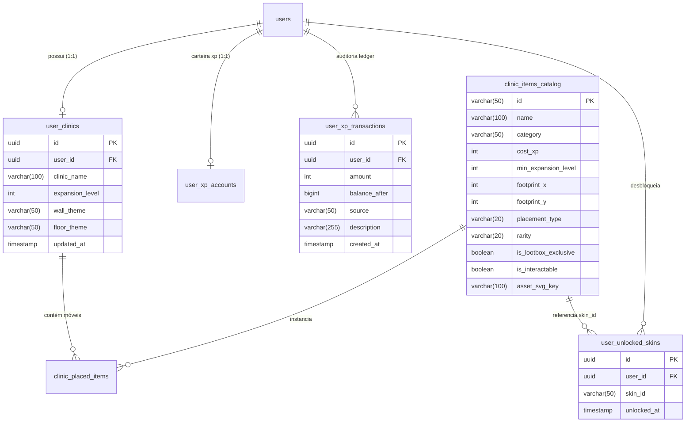

# Documentação de Banco de Dados: Revestimentos de Parede, Piso & Catálogo de Skins da Clínica

> **Localização Mandatória:** `.agents/docs/db/clinic_surfaces_skins.md`  
> **Responsável:** DBA (`dba-expert`)  
> **Referências de Regras:** `.agents/rules/backend-db-performance-rules.md`, `.agents/rules/security-anti-patterns.md`, `.agents/docs/business_rules/minha_clinica_skins_revised.md` (`P-096.1` a `P-096.3`)

---

## 1. Visão Geral do Módulo
- **Domínio de Negócio:** Gamificação Médica, Customização Espacial Isométrica 2.5D e Identidade do Avatar Residente.
- **Propósito:** Persistir com integridade transacional ACID o desacoplamento de revestimentos verticais de parede (`wall_theme`) e lajes de piso (`floor_theme`), gerenciar o catálogo oficial de 8 superfícies padronizadas em `clinic_items_catalog`, auditar a posse cosmética legítima através de `user_unlocked_skins` e integrar com o livro-razão contábil imutável de XP (`user_xp_transactions`) durante as operações de compra.
- **Mecanismo de Persistência:** PostgreSQL 16 (Flyway Migrations — `V31__sync_official_clinic_surfaces_catalog.sql`).

---

## 2. Diagrama Entidade-Relacionamento (ERD)

---

## 3. Governança LGPD, Privacy by Design e Travas Anti-Perda de Dados (DLP)

| Tabela / Coluna | Classificação LGPD | Base Legal (Art. 7º e 11) | Estratégia de Privacidade (*Privacy by Design*) |
| :--- | :--- | :--- | :--- |
| `user_clinics.wall_theme`, `floor_theme` | Dado Funcional Não-Sensível | Execução de Contrato (Art. 7º, V) | Armazena apenas chaves descritivas do tema visual (ex: `'wallpaper_geometric_teal'`). Zero PII. |
| `user_unlocked_skins.skin_id` | Dado Transacional Cosmético | Execução de Contrato (Art. 7º, V) | Vinculada apenas ao `user_id` (`UUID`). Histórico puramente funcional de posse virtual. |
| `clinic_items_catalog` | Dado Público do Sistema | N/A (Não-Pessoal) | Tabela mestra de catálogo global; compartilhada por todos os usuários. |
| `user_xp_transactions` | Histórico Contábil de Estudo | Execução de Contrato (Art. 7º, V) | Rastreabilidade do débito de XP na compra da skin, impedindo adulteração contábil. |

---

## 4. Estrutura de Tabelas e Alterações

### 4.1. Tabela: `clinic_items_catalog` (Catálogo Oficial de Itens & Superfícies)
- **Descrição de Negócio:** Catálogo mestre de bens virtuais colecionáveis, itens médicos e revestimentos de superfícies.

| Coluna | Tipo Primitivo | Nulo? | Padrão (Default) | Descrição / Regra de Negócio |
| :--- | :--- | :--- | :--- | :--- |
| `id` | `VARCHAR(50)` | `NOT NULL` | `N/A` | Chave primária canônica (ex: `wallpaper_geometric_teal`, `tatame_eva`) |
| `name` | `VARCHAR(100)` | `NOT NULL` | `N/A` | Nome amigável de exibição clínica |
| `category` | `VARCHAR(50)` | `NOT NULL` | `N/A` | Categoria funcional (`WALL_SURFACE`, `FLOOR_SURFACE`, `pediatria`, etc.) |
| `cost_xp` | `INT` | `NOT NULL` | `0` | Custo em XP líquido investível (`>= 0`) |
| `min_expansion_level` | `INT` | `NOT NULL` | `1` | Nível mínimo da clínica requerido (1 a 6) |
| `footprint_x` | `INT` | `NOT NULL` | `1` | Largura em tiles no grid (`0` para superfícies e itens de parede) |
| `footprint_y` | `INT` | `NOT NULL` | `1` | Profundidade em tiles (`0` para superfícies e itens de parede) |
| `placement_type` | `VARCHAR(20)` | `NOT NULL` | `'FLOOR'` | `FLOOR`, `WALL`, `SURFACE_WALL` ou `SURFACE_FLOOR` |
| `is_interactable` | `BOOLEAN` | `NOT NULL` | `FALSE` | Flag de micro-interação por clique/som |
| `sound_fx_url` | `VARCHAR(255)` | `NULL` | `NULL` | Identificador de áudio Web Audio API |
| `asset_svg_key` | `VARCHAR(100)` | `NOT NULL` | `N/A` | Chave do asset vetorial no renderizador |
| `rarity` | `VARCHAR(20)` | `NOT NULL` | `'COMMON'` | `COMMON`, `RARE`, `EPIC`, `LEGENDARY` |
| `is_lootbox_exclusive` | `BOOLEAN` | `NOT NULL` | `FALSE` | Se `true`, bloqueado para compra direta na loja |

#### Constraints e Regras de Domínio:
- `chk_clinic_items_catalog_cost_xp`: `cost_xp >= 0`
- `chk_clinic_items_catalog_footprint`: `footprint_x >= 0 AND footprint_y >= 0`
- `chk_clinic_items_catalog_placement_type`: `placement_type IN ('FLOOR', 'WALL', 'SURFACE_WALL', 'SURFACE_FLOOR')`
- `chk_clinic_items_catalog_category`: `category IN ('pediatria', 'mobiliario', 'clinica', 'recepcao', 'revestimentos', 'WALL_SURFACE', 'FLOOR_SURFACE')`
- `chk_clinic_items_catalog_rarity`: `rarity IN ('COMMON', 'RARE', 'EPIC', 'LEGENDARY')`

#### Índices de Performance:
- `idx_clinic_items_catalog_placement_type`: B-Tree em `(placement_type, category)` para filtragem instantânea do catálogo de revestimentos.
- `idx_clinic_items_catalog_rarity_exclusive`: B-Tree em `(rarity, is_lootbox_exclusive)`.

---

### 4.2. Tabela: `user_unlocked_skins` (Inventário de Skins e Superfícies Desbloqueadas)
- **Descrição de Negócio:** Registra a posse de peças cosméticas de avatar e revestimentos de parede/piso adquiridos pelo estudante.

| Coluna | Tipo Primitivo | Nulo? | Padrão (Default) | Descrição / Regra de Negócio |
| :--- | :--- | :--- | :--- | :--- |
| `id` | `UUID` | `NOT NULL` | `gen_random_uuid()` | Chave primária identificadora da posse |
| `user_id` | `UUID` | `NOT NULL` | `N/A` | FK para `users(id) ON DELETE CASCADE` |
| `skin_id` | `VARCHAR(50)` | `NOT NULL` | `N/A` | ID da skin ou superfície desbloqueada |
| `unlocked_at` | `TIMESTAMPTZ` | `NOT NULL` | `NOW()` | Timestamp de aquisição |

#### Constraints & Validações:
- `uk_user_unlocked_skins_user_skin`: UNIQUE (`user_id`, `skin_id`) — previne cobrança duplicada e garante idempotência contábil (`P-096.2`).

#### Índices:
- `idx_user_unlocked_skins_lookup`: B-Tree em `(user_id, skin_id)` para consulta ultra-rápida de posse em `O(1)`.

---

## 5. Estratégia de Migrations

- **Migration UP (Flyway):** `V31__sync_official_clinic_surfaces_catalog.sql`
- **Migration DOWN (Rollback Seguro):** `U31__undo_sync_official_clinic_surfaces_catalog.sql`

### Garantias de Segurança da Migration:
1. **Zero Destruição:** Não utiliza `DROP TABLE`, `DROP COLUMN` ou `TRUNCATE`.
2. **Atualização Atômica de Constraints:** Utiliza bloco seguro PL/pgSQL (`DO $$ BEGIN ... END $$`) para alterar as restrições sem bloquear tabelas de produção.
3. **Idempotência Garantida:** Todos os 8 registros são sincronizados via `ON CONFLICT (id) DO UPDATE SET ...`.
